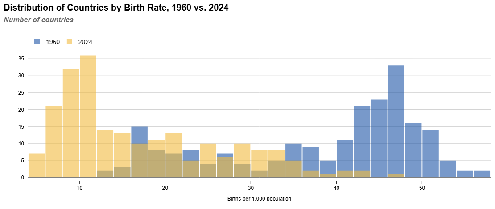
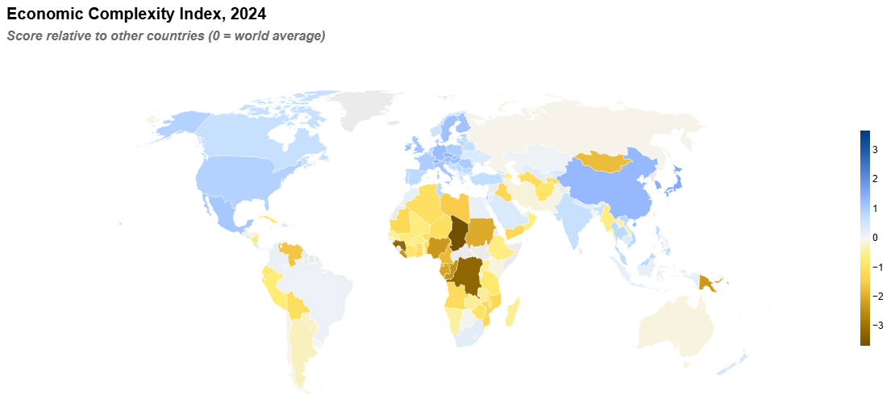
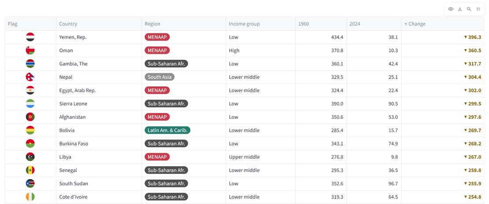
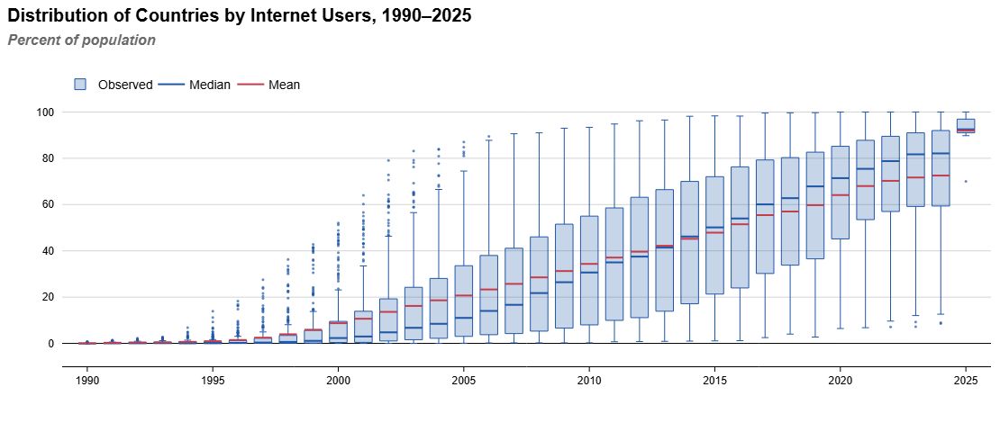

# Global Shifts & Trends Tracker

**Live app: [global-shifts-and-trends-tracker-app.streamlit.app](https://global-shifts-and-trends-tracker-app.streamlit.app/)**

This app gathers a curated set of publicly available indicators, from fiscal figures to
self-reported happiness, to show how the world and its countries have changed over recent decades.

<table>
<tr>
<td width="50%" align="center"><b>Distribution in two years</b> </td>
<td width="50%" align="center"><b>World map</b> </td>
</tr>
<tr>
<td width="50%" align="center"><b>Country details</b> </td>
<td width="50%" align="center"><b>Distribution by year</b> </td>
</tr>
</table>

The app has two tabs:

- **Period & Country Comparisons** (the landing tab) is the cross-country view of one indicator.
  Pick an indicator group, one of its indicators (67 in all) and two years. The tab draws a histogram
  of countries across value bins for both years, a world map switchable between either year and the
  change between them, a sortable table of every country with both values and the change, and a box
  plot per year over the indicator's whole period.
- **Country Profiles** is the time-series view of one entity: the World, a World Bank region or income
  group, or any of 217 countries. It draws 52 charts in nine sections, three per row, with reference
  lines for widely used targets (such as replacement-level fertility) and each source's latest release
  date under every chart.

The app needs no local data files -- it pulls the data live from the publishers'
APIs each time the cache expires (once a day), so the numbers stay current. The
Country Profiles line charts draw each series solid over observed years and dotted
over forecast years (stacked bar charts draw forecast years at half strength).
No chart shades the forecast period.

## Indicators tracked

| Group | Indicators | Data Sources |
|---|---|---|
| Economics | <ul><li>Real GDP growth</li><li>Consumer prices</li><li>Unemployment rate</li><li>Government revenue and expenditure</li><li>Government budget balance</li><li>General government gross debt</li><li>Current account balance</li><li>Foreign direct investment, net inflows</li><li>Domestic credit to private sector</li><li>Price level relative to the US</li><li>Net energy imports</li><li>GDP, PPP</li><li>Output by sector</li><li>Employment by sector</li></ul> | <ul><li>IMF, World Economic Outlook</li><li>World Bank, World Development Indicators</li></ul> |
| Labour market | <ul><li>Labour force participation rate</li><li>Youth not in employment, education or training</li><li>Labour income share</li></ul> | <ul><li>World Bank, World Development Indicators</li><li>International Labour Organization, ILOSTAT</li></ul> |
| Industry & innovation | <ul><li>Manufacturing contribution to GDP</li><li>Medium and high-tech manufacturing</li><li>Manufactured exports</li><li>Economic Complexity Index</li><li>Research and development expenditure</li></ul> | <ul><li>World Bank, World Development Indicators</li><li>Harvard Growth Lab, Atlas of Economic Complexity</li></ul> |
| Living standards | <ul><li>GDP per capita, PPP</li><li>GNI per capita, PPP</li><li>Median income or consumption</li><li>Income inequality (Gini index)</li><li>Poverty at $3.00 a day</li><li>Happiness: life evaluation</li></ul> | <ul><li>World Bank, World Development Indicators</li><li>World Bank, Poverty and Inequality Platform</li><li>Standardized World Income Inequality Database</li><li>World Happiness Report</li></ul> |
| Demographics | <ul><li>Total population</li><li>Annual population growth rate</li><li>Birth and death rates</li><li>Total fertility rate</li><li>Under-5 mortality rate</li><li>Age group shares</li><li>Age dependency ratio</li><li>Life expectancy at birth</li><li>Natural population growth and net migration</li></ul> | <ul><li>World Bank, Population estimates and projections</li></ul> |
| Climate | <ul><li>Greenhouse gas emissions per capita</li><li>Total greenhouse gas emissions</li><li>Energy intensity</li><li>Renewable energy share</li><li>Forest area</li><li>ND-GAIN country index</li><li>Vulnerability and readiness to climate change</li></ul> | <ul><li>World Bank, World Development Indicators</li><li>EDGAR (European Commission JRC) and IEA, via the World Bank</li><li>University of Notre Dame, ND-GAIN Country Index</li></ul> |
| Infrastructure & basic services | <ul><li>Basic drinking water, sanitation and hygiene</li><li>Access to electricity and clean cooking</li><li>Internet users</li></ul> | <ul><li>World Bank, World Development Indicators</li></ul> |
| Education | <ul><li>Government expenditure on education</li><li>Mean and expected years of schooling</li><li>Tertiary school enrollment</li></ul> | <ul><li>World Bank, World Development Indicators</li><li>UNDP, Human Development Report</li></ul> |
| Healthcare | <ul><li>Current health expenditure</li><li>Out-of-pocket health spending</li></ul> | <ul><li>World Bank, World Development Indicators</li></ul> |

## Licence

The code is licensed under the [PolyForm Noncommercial License 1.0.0](LICENSE). The licence covers the
code only: the data shown in the app belongs to its publishers and is subject to their terms, listed with
the credits they ask for in [DATA_SOURCES.md](DATA_SOURCES.md).
